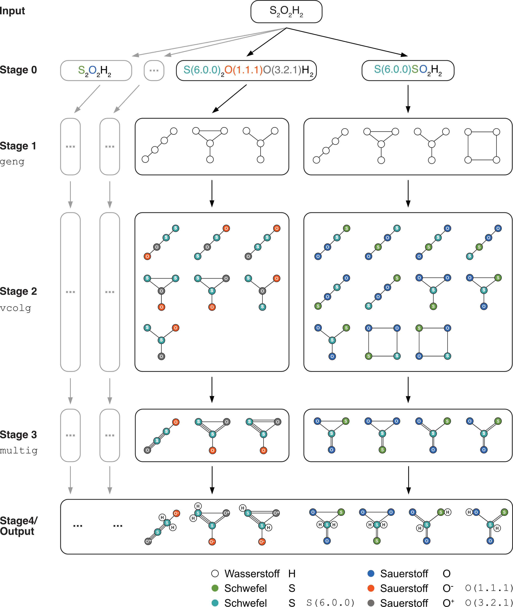

# surge-ext — Extended Chemical Structure Generator

**surge-ext** extends the chemical structure generator [surge](https://github.com/StructureGenerator/surge) with variable-valence enumeration, formal-charge states, element-state exclusions, and parallel scheduling of valence assignments. It generates constitutional-isomer graphs for a molecular formula using canonical augmentation and [nauty](https://pallini.di.uniroma1.it/), subject to the supported element states and selected constraints.

This software was developed in the context of a Bachelor's thesis by Federico Nellen at Heinrich-Heine University Düsseldorf, within the [Algorithmic Bioinformatics](https://albi.hhu.de) research group.

## Table of Contents

- [surge-ext — Extended Chemical Structure Generator](#surge-ext--extended-chemical-structure-generator)
  - [Table of Contents](#table-of-contents)
  - [Scientific scope and motivation](#scientific-scope-and-motivation)
  - [Key features](#key-features)
  - [Documentation](#documentation)
  - [Installation](#installation)
    - [Requirements](#requirements)
    - [Automated build (recommended)](#automated-build-recommended)
    - [Manual build](#manual-build)
    - [Docker usage](#docker-usage)
  - [Usage](#usage)
  - [Command-line interface](#command-line-interface)
  - [Variable valence specification](#variable-valence-specification)
  - [Variable-valence enumeration model](#variable-valence-enumeration-model)
  - [Comparison to upstream surge](#comparison-to-upstream-surge)
  - [Roadmap](#roadmap)
  - [Related tools and ecosystem](#related-tools-and-ecosystem)
    - [Open-source structure generators](#open-source-structure-generators)
    - [Performance context](#performance-context)
  - [References](#references)
  - [Cite this software](#cite-this-software)
    - [Citing the upstream algorithm](#citing-the-upstream-algorithm)

---

## Scientific scope and motivation

Enumerating constitutional isomers provides candidate structures for tasks such as computer-assisted structure elucidation, virtual screening, and theoretical spectroscopy. Generated graphs satisfy the program's formal valence and structural constraints; they are not predictions of chemical stability or experimental observability.

Molecules are represented as labeled graphs whose vertices encode elements and formal charges, and whose edges encode bond orders. The original _surge_ uses canonical augmentation to generate representatives of graph-isomorphism classes. surge-ext runs this pipeline for allowed distributions of valence and charge states.

The extensions provide:

- Systematic enumeration across multiple valence assignments per element (variable valences).
- Support for ionic and zwitterionic species.
- Parallel scheduling of variable-valence splits for large combinatorial spaces.
- Enumeration within the implemented element-state model and selected structural limits. The upstream algorithm's correctness arguments do not by themselves validate every extension in this fork.

---

## Key features

- Constitutional-isomer enumeration within the supported element-state model.
- Support for variable valences (e.g. S, P, halogens).
- Enumeration of ions and internal charge-separated (zwitterionic) structures.
- Parallelized variable-valence enumeration for large search spaces.
- SMILES, SDF, and alphabetic output formats.
- Modular plugin system for customized generators.
- CMake builds and Docker packaging.

---

## Documentation

- **Current extensions and usage**: [docs/surge-ext_v2.0.md](docs/surge-ext_v2.0.md)
- **Historical upstream manual**: [docs/surge_v1.0.md](docs/surge_v1.0.md)

The upstream manual is reference material, not a compatibility guarantee. See the
extensions manual for changed defaults, element tokens, and unavailable options.

---

## Installation

### Requirements

For native builds:

- C compiler (GCC or Clang)
- CMake
- Linux (Debian/Ubuntu recommended) or macOS

The build process automatically downloads and compiles **nauty**.

```bash
sudo apt update
sudo apt install build-essential cmake curl
```

Alternatively, Docker packages the build dependencies and runtime in a container.

---

### Automated build (recommended)

```bash
chmod +x build.sh
./build.sh
```

The interactive build script provides:

1. Native build (Release mode, output in `build/surge-ext`)
2. Docker image build (`surge-ext`)

---

### Manual build

```bash
chmod +x setup.sh
./setup.sh
cmake -S . -B build -DCMAKE_BUILD_TYPE=Release
cmake --build build
```

This command works without `nproc`. The native option in `build.sh` currently
uses `nproc`, so on stock macOS use the manual build commands instead.

---

### Docker usage

```bash
docker build -t surge-ext .
docker run --rm surge-ext -S C10H16O
```

The multi-stage image includes gzip support. Build tools are not included in
the runtime image.
Both nauty and surge-ext use portable compiler settings rather than instructions
specific to the build machine.

Mount your working directory at `/data` to read an exclusion list and save output
on the host:

```bash
docker run --rm -v "$PWD:/data" surge-ext \
  -V -S -F exclusions.txt -o results.smi C4H6O
```

For native CMake builds, host-specific Release optimizations remain enabled by
default. Set `-DNATIVE_OPTIMIZATIONS=OFF` to disable them. External nauty builds
can be selected with `-DNAUTY_DIR=/path/to/nauty` and
`-DNAUTY_LIB=/path/to/nauty/nautyW1.a`.

---

## Usage

Native binary:

```bash
./build/surge-ext -S C8H6N2
```

Docker container:

```bash
docker run --rm surge-ext -S C8H6N2
```

Molecular records go to stdout (or the file selected by `-o`). The startup
banner, progress bars, verbose diagnostics, and final summary go to stderr, so
redirecting stdout produces a clean result file:

```bash
./build/surge-ext -V -S C4H6O > results.smi
```

Variable-valence progress counts both completed workers and splits rejected
before spawning. It always renders a final completion update; no merge bar is
shown for empty or count-only output. If no variable families need expansion,
the single-run fast path prints only the final summary. SDF output preserves
formal charges using `M  CHG` records. With a zlib-enabled build, `-z` compresses
the output, including parallel variable-valence runs.

Interactive terminals use a compact header, progress bars sized to the terminal,
and a labeled result summary with wall-clock elapsed time. Colors are automatic;
set `NO_COLOR=1` or `CLICOLOR=0` to disable them. `TERM=dumb` and redirected stderr
use plain text with no cursor controls. Redirected logs retain the `>Z` summary
fields for scripts, and progress updates are limited to once per second plus
the initial and final states. Skipped worker diagnostics stay in the error log
unless `-v` is enabled; input errors are always shown directly.

---

## Command-line interface

```text
Usage: surge-ext [-oFILE] [-z] [-u|-A|-S] [-T] [-V] [-Z] [-I] [-j#]
                 [-Xstate] [-Ffile] [-e#|-e#:#] [-d#] [-c#] [-m#/#] formula
```

Known elements: H, B, C, N, O, F, Al, Si, P, S, Cl, Br, I

Selected options:

- `-S` Output SMILES
- `-A` Alphabetical format
- `-u` Count only (no output)
- `-V` Enable variable valences
- `-Z` Allow net-neutral charge-separated assignments as well as neutral ones (with `-V`)
- `-I` Allow ions as well as neutral assignments; mixed charge signs are rejected (with `-V`)
- `-j#` Maximum simultaneous variable-valence workers (default 1)
- `-c#` Maximum distinct neighbours including hydrogen (default 6)
- `-d#` Maximum distinct non-hydrogen neighbours (default 6)
- `-Xstate` Exclude an exact element state (repeatable)
- `-Ffile` Read excluded states from a file (repeatable)
- `-P` Enforce planarity
- `-o` Output file

A full description of all constraints and structural filters is provided in the manual.

Both limits can still be overridden, for example with `-c4 -d4` to restore the
previous limits. The defaults allow six-coordinate structures such as
`'S(6.0.0)F6'` without additional flags; allowed element states and the restriction
on hydrogen neighbours above coordination 4 still apply.

---

## Variable valence specification

Elements with multiple allowed valences and charges can be specified explicitly using:

```text
Element(valence.sign.charge)
```

Here `valence` is the sum of bond orders, `sign` is 0 (neutral), 1 (negative),
or 2 (positive), and `charge` is the nonnegative charge magnitude. Only tokens
listed in the element table are accepted; for example, neutral divalent sulfur
is `S`, not `S(2.0.0)`.

Example:

```bash
./build/surge-ext -S 'S(6.0.0)F6'
```

Multiple valence variants of the same element may be combined in a single formula.

### Excluding element states

Exclude individual states before variable-valence enumeration with `-X`:

```bash
./build/surge-ext -V -S -X 'C(2.0.0)' C4H6O
```

For a longer list, use `-F exclusions.txt`. Each nonempty line contains one
exact state token; surrounding whitespace, blank lines, and `#` comments are
allowed. For example:

```text
# Do not enumerate these states
C(2.0.0)
N(4.2.1)  # positive nitrogen
```

```bash
./build/surge-ext -V -S -F exclusions.txt C4H6O
```

Both options accept attached or separate arguments (`'-XC(2.0.0)'` or
`-X 'C(2.0.0)'`, `-Fexclusions.txt` or `-F exclusions.txt`). Repeated `-X` and
`-F` options combine their exclusions; duplicates are harmless. Quote state
tokens containing parentheses in your shell.

Matching is exact: `-X C` excludes the ordinary tetravalent carbon state, not
all carbon states. With `-V`, bare `C` in the formula still supplies carbon atoms
that can be assigned to the remaining allowed states. Explicit variants in the
formula cannot be excluded. Without `-V`, requesting any excluded state,
including bare `C`, is an error. Unknown exclusions, unreadable files, and
excluding every available state of an element needed by the formula are errors.
Charge restrictions from `-I`/`-Z` still apply.

---

## Variable-valence enumeration model

With `-V`, bare element tokens are distributed across their allowed states;
explicit variants such as `S(6.0.0)` remain fixed. Exclusions and charge-mode
restrictions narrow the assignments, and infeasible assignments are skipped.
Each remaining distribution runs through the structure-generation pipeline.
If no families need expansion, the formula runs directly through the pipeline.

An overview of the enumeration workflow is shown below:



---

## Comparison to upstream surge

| Feature              | surge          | surge-ext |
| -------------------- | -------------- | --------- |
| Fixed valence        | ✔              | ✔         |
| Variable valence     | ✘              | ✔         |
| Ions                 | ✘              | ✔         |
| Zwitterions          | ✘              | ✔         |

surge-ext adds worker scheduling across variable-valence assignments. Upstream
also documents residue/modulus splitting for separately launched processes;
these are different forms of parallel execution.

---

## Roadmap

Planned developments include:

- Extension to additional elements and states beyond the current table
- Validation against large chemical databases (e.g. PubChem)
- Post-processing for tautomer and resonance equivalence
- Integration with RDKit and related toolkits
- Expanded plugin documentation
- Graphical user interface

---

## Related tools and ecosystem

### Related structure-generation tools

- **MOLGEN** — Established standard with extensive constraint support (closed-source, limited availability)
- **MAYGEN** — Open-source generator using orderly generation
- **enu** — Includes stereoisomer enumeration
- **Sherlock** — NMR-guided structure elucidation

### Performance context

The 2022 surge publication reports benchmarks for the upstream generator.
Those results do not establish surge-ext's performance: variable-valence runs
may require many separate generation passes. No fork-specific comparative
benchmark is provided here.

---

## References

- Original surge repository: [https://github.com/StructureGenerator/surge](https://github.com/StructureGenerator/surge)
- Nauty & Traces: [https://pallini.di.uniroma1.it/](https://pallini.di.uniroma1.it/)
- surge publication: McKay, B. D., Yirik, M. A., & Steinbeck, C. (2022). Surge: a fast open-source chemical graph generator. _Journal of Cheminformatics_, 14(1), 24. [https://doi.org/10.1186/s13321-022-00604-9](https://doi.org/10.1186/s13321-022-00604-9)

## Cite this software

If you use surge-ext in academic work, please cite it as software and acknowledge its relationship to the original surge generator.

Nellen, F. (2025). surge-ext: An extended chemical structure generator with variable valence chemistry and zwitterion support (Version 2.0) [GitHub](https://github.com/AlBi-HHU/surge-ext)

```bibtex
@software{nellen_surge_ext_2025,
  author       = {Nellen, Federico},
  title        = {surge-ext: Extended chemical structure generation with variable valences, ions, and zwitterions},
  year         = {2025},
  institution  = {Heinrich-Heine University Düsseldorf},
  url          = {https://github.com/AlBi-HHU/surge-ext},
  note         = {Extended fork of the surge chemical structure generator}
}
```

### Citing the upstream algorithm

If your work relies on the underlying generation algorithm, please also cite the original surge publication:

```bibtex
@Article{McKay2022,
author={McKay, Brendan D.
and Yirik, Mehmet Aziz
and Steinbeck, Christoph},
title={Surge: a fast open-source chemical graph generator},
journal={Journal of Cheminformatics},
year={2022},
month={Apr},
day={23},
volume={14},
number={1},
pages={24},
abstract={Chemical structure generators are used in cheminformatics to produce or enumerate virtual molecules based on a set of boundary conditions. The result can then be tested for properties of interest, such as adherence to measured data or for their suitability as drugs. The starting point can be a potentially fuzzy set of fragments or a molecular formula. In the latter case, the generator produces the set of constitutional isomers of the given input formula. Here we present the novel constitutional isomer generator surge based on the canonical generation path method. Surge uses the nauty package to compute automorphism groups of graphs. We outline the working principles of surge and present benchmarking results which show that surge is currently the fastest structure generator. Surge is available under a liberal open-source license.},
issn={1758-2946},
doi={10.1186/s13321-022-00604-9},
url={https://doi.org/10.1186/s13321-022-00604-9}
}
```
