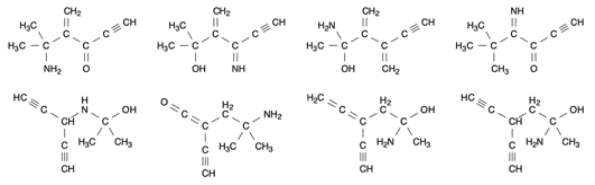
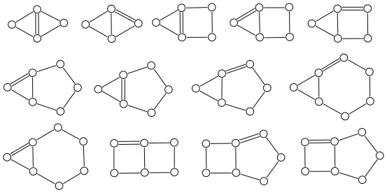
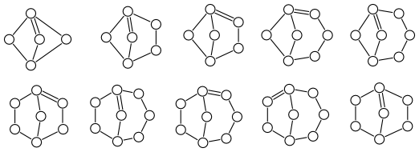
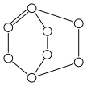
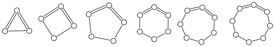
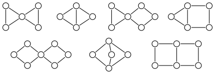

# Users' manual for molecule generator `surge`

> **Historical upstream manual.** This document describes surge v1.0, not the
> current surge-ext CLI. In surge-ext, `-c` and `-d` default to 6, legacy aliases
> such as `Nx`, `Px`, `Sx`, and `Sy` are unavailable, and `-E` is not implemented.
> Plugin interfaces and examples also differ: `-F` now reads an element-state
> exclusion file rather than selecting the historical plugin's atom-count filter.
> See the [current extensions manual](surge-ext_v2.0.md) before using these examples.

Brendan D. McKay

School of Computing
Australian National University
Canberra, ACT 2601, Australia
brendan.mckay@anu.edu.au

Christoph Steinbeck and Mehmet Aziz Yirik

Institute of Inorganic and Analytical Chemistry
Friedrich-Schiller-University, 07743 Jena, Germany
christoph.steinbeck@uni-jena.de
yirik.mehmetaziz@uni-jena.de

VERSION 1.

Abstract
This is the manual for the molecule generator `surge`.

## 1 Introduction

`Surge` is a command-line generator of chemical structures. It is written in a portable
subset of the C language and runs on any computer that can run `nauty`.

- See Appendix A for installation instructions.
- See [2] for a description of how `surge` works.

## 2 Basic usage

The only compulsory input is a chemical formula. Add `-u` if you only want to count the molecules and not to write them. For example:

```bash
surge -u C8H11NO
>Z generated 17379 -> 500039 -> 2123287 in 0.12 sec
```

Here `surge` has reported that it found $2,123,287$ molecules in 0.12 seconds. Some of the molecules are shown in Figure 1.


_Figure 1: Some of the $2,123,287$ molecules produced by `surge` C8H11NO._

The other numbers, $17,379$ and $500,039$, reported by `surge` give a glimpse of its inner workings. `Surge` first generates simple graphs (graphs with no vertex labels and all edges simple), then it assigns elements to the vertices, then finally it assigns bond type (single, double or triple) to each edge.

For example, Agrocybyne B, found in the edible brown mushroom agrocybe praecox, is made in three stages as shown in Figure 2.

Figure 2: The three stages of generating Agrocybyne B.

The output "17379 -> 500039 -> 2123287" from `surge` means that 17,379 simple graphs were generated, elements were assigned to the vertices in 500,039 ways, then bond multiplicities were assigned to make 2,123,287 molecules.

Execution of `surge` with no arguments, or with the single argument `-help` produces a brief usage description. Next we will describe the available options in detail.

Options are indicated by a hyphen in the Unix style, such as `-u`. They can be concatenated or written separately:`-u -t0`is the same as `-ut0`. The single exception is the option `-oFILE` (specify output file) where the file name is everything from the `-o` to the
end of the option.

If options have values, they must be written against the option name and not separately: `-t2` is valid but `-t 2` is not.

| Element        | Symbol | Input Symbol | Valence | Max-Coord | Index |
| :------------- | :----: | :----------: | :-----: | :-------: | :---: |
| Carbon         |   C    |      C       |    4    |     4     |   0   |
| Nitrogen       |   N    |      N       |    3    |     3     |   1   |
| Nitrogen (x)   |   N    |      Nx      |    5    |     4     |  10   |
| Oxygen         |   O    |      O       |    2    |     2     |   2   |
| Phosphorus     |   P    |      P       |    3    |     3     |   3   |
| Phosphorus (x) |   P    |      Px      |    5    |     5     |  13   |
| Sulfur         |   S    |      S       |    2    |     2     |   4   |
| Sulfur (x)     |   S    |      Sx      |    4    |     4     |  11   |
| Sulfur (y)     |   S    |      Sy      |    6    |     6     |  12   |
| Fluorine       |   F    |      F       |    1    |     1     |   5   |
| Chlorine       |   Cl   |      Cl      |    1    |     1     |   6   |
| Bromine        |   Br   |      Br      |    1    |     1     |   7   |
| Iodine         |   I    |      I       |    1    |     1     |   8   |
| Boron          |   B    |      B       |    2    |     2     |   9   |
| Silicon        |   Si   |      Si      |    4    |     4     |  14   |
| Hydrogen       |   H    |      H       |    1    |     1     |   –   |

Table 1: List of elements known to `surge` by default.

## 3 Specifying the molecular formula

The molecular formula is specified by a string of symbols and numbers, without punctuation. Elements are given by the `input symbol` as shown in Table 1.

Note that some elements can have multiple valences, for example phosphorus can have valence 3 or 5. Following the table, writing `P` indicates phosphorus at valence 3, while `Px` indicates phosphorus at valence 5. With one exception that will be noted later, output
uses the standard chemical symbol; the `input symbol` is only for input. For example, `surge C3Sx2H` specifies 3 carbon atoms, 2 sulphur atoms at valence 4, and 4 hydrogen atoms.

The value `max-coord` shown in Table 1 is the maximum coordination number of that element; that is, the maximum number of distinct neighboring atoms including hydrogen (ignoring bond multiplicities).`Surge` imposes two restrictions for chemical reasons:

1. If an atom has 5 or more neighbors, none of the neighbors are hydrogen.
2. Nitrogen atoms can have at most 4 neighbors. Note that you need the `-c` and/or `-d` options to allow more than 4 neighbors, see Section 6.

Additional elements can added at run time, see Section 8.

## 4 Output options

- `-u` Don’t write any molecules; just generate them and report the number.
- `-oFILE` Specify a file name for output, to be used instead of the standard output. You can specify names with spaces or special characters by using quotes, for example `-o'Very Many Molecules.smi'`
- `-v` Write some additional statistics to standard error.
- `-z` Except for the cases of `-u` and `-O1`, the output is gzipped. This option is only available if `surge` has been built with the `zlib` library (see Appendix A).
- `-m#/#` (where each # is a number) This option tells `surge` to do only a part of the generation. If the two numbers are res and mod, respectively, it must be that $0 \leq res \leq mod - 1$. For example, to split the generation into four parts which can be run independently, use `-m0/4`, `-m1/4`, `-m2/4` and `-m3/4` respectively on the parts. The overhead in this splitting is very low. However, if the number of parts is large some of the parts may be a lot bigger than others.

The output formats available are illustrated in Figure 3. Note that hydrogen is not explicitly represented in any of the formats.

- `-S` Output in SMILES format compatible with the OpenSMILES specification [5]. Note that this version of `surge` does not understand aromaticity, so only single, double or triple bonds are possible. See Figure 3(b).

- `-A` Output in "alphabetic format", which is unique to `surge`. The example in Figure 3(c) starts "10 9" which means 10 atoms and 9 bonds (not counting hydrogen in either case). Then follows the chemical formula `C8NOH11`, which may have the elements in a different order from what you gave. This is the sole output format where the input symbols are used in place of standard symbols, in order to show the valence. The non-hydrogen atoms are numbered in the order they appear in the formula starting with 0: atoms 0–7 are `C`, atom 8 is `N` and atom 9 is `O`. Then the bonds are listed using the atom numbers with `-` for single, `=` for double and `#` for triple.

1. `surge C8H11NO` — Default output in SDfile format.

```sdfile
10 9 0 0 0 0 999 V
0.0000 0.0000 0.0000 C 0 0 0 0 0 4 0 0 0 0 0 0
0.0000 0.0000 0.0000 C 0 0 0 0 0 4 0 0 0 0 0 0
0.0000 0.0000 0.0000 C 0 0 0 0 0 4 0 0 0 0 0 0
0.0000 0.0000 0.0000 C 0 0 0 0 0 4 0 0 0 0 0 0
0.0000 0.0000 0.0000 O 0 0 0 0 0 2 0 0 0 0 0 0
0.0000 0.0000 0.0000 N 0 0 0 0 0 3 0 0 0 0 0 0
0.0000 0.0000 0.0000 C 0 0 0 0 0 4 0 0 0 0 0 0
0.0000 0.0000 0.0000 C 0 0 0 0 0 4 0 0 0 0 0 0
0.0000 0.0000 0.0000 C 0 0 0 0 0 4 0 0 0 0 0 0
0.0000 0.0000 0.0000 C 0 0 0 0 0 4 0 0 0 0 0 0
1 5 2 0 0 0 0
1 6 1 0 0 0 0
1 8 1 0 0 0 0
2 7 1 0 0 0 0
2 9 1 0 0 0 0
3 8 3 0 0 0 0
3 10 1 0 0 0 0
4 9 1 0 0 0 0
4 10 2 0 0 0 0
M END
$$$$
```

2. `surge -S C8H11NO` — SMILES output format.

```smiles
CCCC=CC#CC(=O)N
```

3. `surge -A C8H11NO` — Alphabetic output format.

```alphabetic
10 9 C8NOH11 0=9 0-8 0-5 1-4 1-6 2#5 2-7 3-6 3=
```

4. `surge -O3 C8H11NO` — Numeric output format.

```numeric
10 9 0 0 0 0 2 1 0 0 0 0 0 4 1 0 5 0 0 7 0 1 6 0 1 8 0 2 7 2 2 9 0 3 8 0 3 9 1
```

`-O#` (where `#` is $1$, $2$ or $3$). This is intended mostly for debugging purposes, but `-O` is probably the simplest output to read with a program. For `-O1` and `-O2`, the generation only goes as far as stages 1 and 2, respectively (recall Figure 2). For `-O1`, unlabelled simple graphs are written in `nauty`'s `graph6` format.
For `-O2`, simple graphs with elements assigned to vertices are written. At this stage, bond multiplicities have not been chosen. The output line for Agrocybyne B is

```numeric
10 9 0 0 0 0 2 1 0 0 0 0 0 4 0 5 0 7 1 6 1 8 2 7 2 9 3 8 3 9
```

which means $10$ vertices arbitrarily numbered $0–9$, $9$ edges, the elements assigned to the vertices (using the "index" column from Table 1), then a list of 9 edges (0–4, etc.). This format is compatible with the `-T` output of the `nauty` utility `vcolg`. For `-O3`, complete generation of molecules is performed and they are written in the format shown in Figure 3(d). It is the same as `-O2` except that each edge is followed by a bond multiplicity indicator: 0 means single, 1 means double, 2 means triple. This format is compatible with the `-T` output of the `nauty` utility `multig`.

Default. If none of `-u`,`-S`,`-A` or `-O` are given, the output is in SDfile format [1] like in Figure 3.1. Note that the valence column of the atom block is always filled in.

The choice of output format can make a large difference to the running time, because `surge` generates molecules much faster than they can be written. Here are representative times for `C8N2O2H12`, for which there are $377,394,455$ isomers. We are writing to a fast
pipe, and the times would be even greater if we wrote to a physical device. The deciding factor is the number of bytes that must be written, which is the main reason why SDfile output is comparatively slow.

- `-u` (no output) 15 seconds
- `-S` (SMILES) 8.3 GB in 53 seconds
- `-A` (alphabetic) 25.7 GB in 81 seconds
- `-O3` (numeric) 41.1 GB in 88 seconds
- Default (SDfile) 422 GB in 1365 seconds.

If you are looking for a needle in a haystack—a few special molecules in a vast collection—the most efficient approach is to test before writing, as explained in Section 9.

## 5 Rings and cycles

Our description of `surge` options takes care to distinguish two types of closed path, which
we call ring and cycles.

A _cycle_ is a closed path that does not repeat any atom except that it finishes on the same atom it started on. A _ring_ is a cycle with the additional restriction that there is no bond between any of its atoms apart from the bonds forming the cycle. (In graph theory language, a ring is a _chord-free cycle_, also known as an _induced cycle_.) Every ring is a cycle, but a cycle may or may not be a ring.

Naphthalene has two rings of length 6, but three cycles (the two rings, plus a cycle of length 10). The cycle of length 10 is not a ring because of the extra bond between two of its atoms.


_Four `surge` options restrict the cycles of the molecule._

- `-t#` or `-t#:#` (where each # is a number). Specify the allowed number of cycles of length 3. For example, `-t0` or `-t1:3`. Recall that option values have to written against the option letter; you can’t write `-t` 0.
- `-f#` or `-f#:#` (where each # is a number). Specify the allowed number of cycles of length 4. For example, `-f0` or `-f1:3`.
- `-p#` or `-p#:#` (where each # is a number). Specify the allowed number of cycles of length 5. For example, `-p0` or `-p1:3`.

- `-b` Specify that no cycles of odd length are permitted. A simple exercise is that there is a cycle of odd length if and only if there is a ring of odd length, so an equivalent description is that no rings of odd length are permitted. (In graph theory language, the graph is bipartite.)

## 6 Other global structural restrictions

- `-e#` or `-e#:#` (where each # is a number). Specify the allowed number of bonds (ignoring attached hydrogens). Bonds are counted without regard to their multiplicity. Examples: `-e15` or `-e12:13`. If the number of atoms is $n$ and the number of bonds is $e$, then $e−n+ 1$ is the minimum number of bonds that need to be broken to reach an acyclic structure.
- `-d#` Specify an upper bound on the number of distinct neighbors that are not hydrogen atoms. The default is 4.
- `-c#` Specify an upper bound on the number of distinct neighbors including hydrogen atoms. The default is 4.
- `-T` Forbid triple bonds.
- `-P` Require that the molecule be planar. That is, it can be drawn in the plane with no bonds crossing.

## 7 Forbidden substructures

`Surge` has the facility to remove molecules which contain certain substructures using the `-B` option. The argument of `-B` is a list of numbers separated by commas without spaces. For example, `-B2,3,8`. Each number indicates a set of substructures that are forbidden.
You can use `-B` more than once, for example `-B2,4,6` is the same as `-B4 -B6,2`. We will describe the meaning of each number separately. In some cases it is necessary to understand the distinction between rings and cycles, as explained in Section 5.

In the pictures, a circle represents any type of atom, a simple join matches any bond, a double join matches a double or triple bond, and a triple join matches only a triple bond. Many of the families below were inspired by MOLGEN [3].

- `-B1` Rings of length up to 7 have no triple bonds. This is equivalent to cycles of length up to 7 having no triple bonds.

  

- `-B2` Consider rings of length $r$ and $s$ which share one bond (i.e. fused rings). Let $e$ be the common bond and let $f$ be any bond belonging to one of the rings and sharing exactly one atom with $e$. In the cases $\{r, s\}=\{ 3 , 3 \},\{ 3 , 4 \}$ and $\{ 3 , 5 \}$, both $e$ and $f$ must be single bonds. In the cases $\{r, s\}=\{ 3 , 6 \},\{ 4 , 4 \}$ and $\{ 4 , 5 \}$, $f$ must be a single bond.

  

- `-B3` Consider rings of length $r$ and $s$ which share two bonds. Let $e$ be one of the shared bonds and let $f$ be a bond belonging to one of the rings and sharing exactly one atom with $e$. In the cases $\{r, s\}=\{ 4 , 4 \},\{ 4 , 5 \},\{ 4 , 6 \},\{ 5 , 5 \}$ and $\{ 5 , 6 \}$, both $e$ and $f$ must be single bonds.

  

- `-B4` Consider two rings of length 6 that share three bonds. Then any bond which lies in one of the rings and has exactly one atom in the other ring must be a single bond.

  

- `-B5` No atom has two double or triple bonds unless it is also bonded to some other non-hydrogen atom.

  

- `-B6` No atom in a ring of length up to 8 has two double bonds unless it is also bonded to some other non-hydrogen atom.

  

- `-B7` These are forbidden: two atoms with four common neighbors, and three atoms with three common neighbors.

  

- `-B8` These are forbidden: a cycle of length 5 having an atom bonded to each of the other 4 atoms, a set of 4 atoms all bonded to each other sharing one bond with a cycle of length 4.

  

- `-B9` Every atom lies on at most one ring of length 3 or 4. Equivalently, every atom lies on at most one cycle of length 3 or 4.

  

## 8 Adding extra elements

Extra elements/valences can be added temporarily using the `-E` option. Any reasonable number of `-E` options can be given. The syntax is one of these:

```bash
-EXv -EXYv -EXvc -EXYvc
```

`X` is the input name of the element (what you must use in the command line molecular formula). `Y` is the standard chemical symbol for this element. If `Y` is omitted, it is assumed the same as `X`.

Both `X` and `Y` must be a single uppercase letter, or an uppercase letter followed by a lowercase letter. `v` and `c` are respectively the valence and the maximum coordination number (the maximum number of distinct neighbors including hydrogen). If `c` is not given, it is the same as `v`. Both `v` and `c` must consist of a single digit.

Example: To add arsenic as As with valence 3, and as Az with valence 5, you can do this: `-EAs3 -EAzAs5`.
The standard chemical formats SMILES (-S) and SDfile (default) will use `As` for both cases, but the distinct input names serve to tell the program which valences to use.

If you want to add elements more permanently, you can do it using the PLUGIN facility (Section 9) and it is also quite easy to add them to the program.

## 9 PLUGIN facility

By compiling code into `surge`, additional features can be efficiently incorporated. To use this feature, create a `C` file which contains any or all of these:

1. variable and function definitions
2. a macro definition for `SURGEPLUGIN_INIT`
3. a macro definition for `SURGEPLUGIN_STEP`
4. a macro definition for `SURGEPLUGIN_STEP`
5. a macro definition for `SURGEPLUGIN_STEP`
6. a macro definition for `SURGEPLUGIN_STEP`
7. a macro definition for `SURGEPLUGIN_SWITCHES`
8. a macro definition for `SURGEPLUGIN_SUMMARY`

The package contains these examples:

1. `plugin0.c`: Remove molecules containing $K_{2,3}$, that is, two atoms having three or more common neighbors. Also add arsenic (`As`) with valence 3 to the table of known elements.
2. `plugin1.c`: Specify the number of atoms with exactly 4 neighbors that are not hydrogen atoms. The required number is given by a new option `-F#` or `-F#:#`.
3. `plugin2.c`: Add an option `-Y` that forbids adjacent oxygens.
4. `plugin3.c`: Count the number of hydrogen atoms attached to carbon atoms, and write the values at the end.

To compile a plugin into the program, include an option like
`-DSURGEPLUGIN='"plugin1.c"'` on the compile command. Note that the plugin code is inserted directly into the `surge` code, not just linked to it. This means that `surge`'s internal variables are visible to the plugin.

1. variable and function definitions – These are placed at the outer program level, before any `surge` functions are defined. Using `static` is recommended. If you define a string as the value of `HELPTEXT2`, it will appear as extra text when the program is run with argument `-help`.
2. `SURGEPLUGIN_INIT` — This is placed right at the beginning of the execution. It can be used for adding extra elements to the table of elements. To do this, call the function `addelement(char *inputname, char *name, int valence, int maxcoord)`. Here, `inputname` is the symbol for the element as used on the command line. All input
   symbols must be unique, even for the the same element at different valences, `name` is the usual chemical symbol for the element, `valence` is the valence, and `maxcoord` is the maximum number of distinct neighbors including hydrogen. Example: To add arsenic
   as `As` at valence 3 and as `Az` at valence 5: `addelement("As","As",3,3); addelement("Az","As",5,5);` SMILES and SDfile output will use `As` for both. You can also use `SURGEPLUGIN_INIT` for initialising global variables used by the plugin.
3. `SURGEPLUGIN_STEP0` — This is placed at intermediate levels in the generation of simple graphs (corresponding to PRUNE in `geng`). Variables available are:

- `graph *g` = the graph so far (`nauty` format)
- `int n` = the number of vertices so far
- `int maxn` = the target number of vertices, equal to the number of non-hydrogen atoms

If can be useful to know that the last vertex added by the program was vertex $n−1$ and the subgraph without that vertex was the most recently seen graph with $n−1$ vertices. If you want to discard this graph and all its extensions, just return the value 1. If not, don’t return.

4. `SURGEPLUGIN_STEP1` — This is placed after simple graphs have been generated and before elements have been assigned to the vertices. That is, at Stage 1. All the `-B` options have already been imposed except `-B5,6`. Also `-t`, `-f`, `-p`, `-b` and `-P` have been imposed. Variables available are:

- `graph *g` = the simple graph for the non-hydrogen atoms
- `int n` = the number of vertices in `g`
- `int deg[0..n-1]` = the degrees of `g`
  If you want to discard this graph, just return.

5. `SURGEPLUGIN_STEP2` — This is placed after elements have been assigned to vertices. That is, at Stage 2. Variables available are:

- `graph *g` = the simple graph for the non-hydrogen atoms
- `int n` = the number of vertices in `g`
- `int ne` = the number of edges in `g`
- `int deg[0..n-1]` = the degrees of `g`
- `edge[0..n-1]` = a list of edges. This is a structured type of which the fields `x,y` give the vertices for this edge. (Here and everywhere in the program except for some output formats, vertices and edges are numbered starting at 0.) Don’t assume any other fields
  are set. So far, multiplicities of edges have not been decided.
- `int vcol[0..n-1]` = the elements assigned to the vertices. The value is an index into the table `element[ ]` that lists all the available elements. See the program text for the fields of `element[ ]`. The function `elementindex(s)` gives the index of the element with
  input names, for example `elementindex("Sx")`. If you want to discard this assignment of elements to vertices, just return.

6. `SURGEPLUGIN_STEP3` — This is executed for each completed molecule. All the command-line restrictions have now been applied. Variables available are:

- `n`,`ne`,`edge`,`vcol` = as for `SURGEPLUGIN_STEP2`
- `int mult[0..ne-1]` = one less than the multiplicity of the bond (ie. 0=single, 1=double, 2=triple)
- `int hyd[0..n-1]` = number of attached hydrogen atoms.
  If you want to discard this molecule, just return.
  Since `surge` generates molecules much faster than it can write them, using this facility to perform strong pruning tests can significantly decrease the total time.

7. `SURGEPLUGIN_SWITCHES` — You can use this to define extra command-line options. See `plugin1.c` and `plugin2.c` for examples.

To define a new option, you need to have a `boolean` variable and if the option takes a value or a range you need variables to hold those values. You can define these variables at step 1. above. The `boolean` variable should be initialized to `FALSE`.

Examples:

```c
SWBOOLEAN('H',Hswitch) //defines Hswitch=TRUEfor-H
SWINT('H',Hswitch,Hval,"surge -H") //specifies an integer parameter
```

For example, `-H6` defines `Hswitch=TRUE` and sets `Hval=6`. "surge -H" appears in an error message if there is any. `Hval` has type `int`.

```c
SWRANGE('H',":-",Hswitch,Hmin,Hmax,"surge -H") // defines an interval.
```

`-H5:7` and `-H5-7` both set `Hswitch=TRUE`, `Hmin=5` and `Hmax=7`. The ends of the interval can be omitted: `-H5:` sets `Hswitch=TRUE`, `Hmin=5`, `Hmax=∞`. `Hmin` and `Hmax` are `long int` variables. To define more than one switch, separate them by else. Example:
`SWBOOLEAN('H',Hswitch) else SWINT('J',Jswitch,Jval,"surge -J")`
with no semicolons.

8. `SURGEPLUGIN_SUMMARY`— You can use this to write information that the plugin code has collected. Write to `stderr`. It is placed at the end of execution just before `surge`'s summary `>Z` line is written. See `plugin3.c` for an example.

The source code for the plugin examples is in Appendix B.

## A Installation

`Surge` is written in a portable subset of the language `C`. The package is available from [7] and [6]. The first site also has some precompiled versions.

Your first task is to install `nauty` if it isn’t installed already [4]. At least `nauty` 2.7 is recommended.

In addition to the include files and library of `nauty`, you need these source files from `nauty` that are also included in the `surge` package for convenience:

- `geng.c`
- `planarity.h`
- `planarity.c`

For best `surge` performance, version 3.3 or later of `geng.c` is needed; see near the start of the source file. If you want `surge` to be able to gzip its output (`-z` option), you also need to install `zlib`[8] if you don’t have it already. If you have the utility make, as you probably will if you are working on Linux, MacOSX or Cygwin, start by editing the definitions of CC, CCOPT, NAUTY, NAUTYLIB, ZLIB and ZLIBLIB that are explained near the start of the file `makefile`.

Then you just need to type

```bash
make surge
```

and it will be done.

If you don’t have make, you can compile surge manually. In the following, replace CC, CCOPT, NAUTY, NAUTYLIB, ZLIB and ZLIBLIB by their meanings as defined in makefile:

```bash
CC -o surge -g -I NAUTY -DWORDSIZE=32 -DMAXN=WORDSIZE \
-DOUTPROC=surgeproc CCOPT -DPREPRUNE=surgepreprune ZLIB \
-DPRUNE=surgeprune -DGENG_MAIN=geng_main surge.c geng.c \
planarity.c NAUTYLIB/nautyW1.a ZLIBLIB
```

`Surge` can be compiled with `-DWORDSIZE=64` if `nautyW1.a` is replaced by `nautyL1.a`. That will raise the limit on the number of non-hydrogen atoms from 32 to 64, but there are very few molecular formulas of that size for which the number of isomers is within
reason. The number of bonds, ignoring hydrogen, is limited in 64 in any case.

## B Sample plugins

In this appendix we give some examples of plugins that use the features described in Section 9.

### Example of `SURGEPLUGIN_STEP0`: `plugin0.c`

```c
/* This is a plugin for surge that removes molecules with
two atoms having three or more common neighbours.
Also, arsenic at valence 3 and 5 is added. */

#define HELPTEXT2 " This version removes molecules with K(2,3).\n"

#define SURGEPLUGIN_INIT \
addelement("As","As",3,3); addelement("Az","As",5,5);

#define SURGEPLUGIN_STEP0 \
{ int ii,jj; \
for (jj = n; --jj >= 1; ) \
for (ii = jj; --ii >= 0; ) \
if (POPCOUNT(g[ii] & g[jj]) >= 3) return 1; }
```

Substructures that only rely on the simple graph structure can be detected at the initial stage. In the special case of removing cases that contain a given simple graph, the most efficient place is during the generation of the simple graphs.

`SURGEPLUGIN_STEP0` is called by `geng` at each level of the simple graph generation. Returning a non-zero value causes this graph and all its descendants to be discarded.

Note that `POPCOUNT` is an `nauty` macro that counts the 1-bits in a word. We enclosed the code in braces `{ }` to avoid possible conflict with surge variables.

### Example of `SURGEPLUGIN_STEP1`: `plugin1.c`

```c
/* This is a plugin for surge that implements an extra option
-F# or -F#:# for the number of atoms with exactly 4 distinct
non-H neighbours. */

#define HELPTEXT2 \
" -F# -F#:# Specify number of atoms with exactly 4 non-H neighbours\n"

static boolean Fswitch = FALSE;
static long Fmin,Fmax;

#define SURGEPLUGIN_STEP1 \
{ int ii,Fval; Fval=0; \
for (ii = 0; ii < n; ++ii) if (deg[ii] == 4) ++Fval; \
if (Fswitch && (Fval < Fmin || Fval > Fmax)) return; }

#define SURGEPLUGIN_SWITCHES \
SWRANGE('F',":-",Fswitch,Fmin,Fmax,"surge -F")
```

`SURGEPLUGIN_STEP1` is placed at the point where generation of simple graphs is complete. This code counts the number of vertices of the simple graph that have degree 4 and executes `return` to discard the graph if the count isn’t within the bounds given by the -F option.

### Example of `SURGEPLUGIN_STEP2`: `plugin2.c`

```c
/* This is a plugin for surge that optionally forbids
adjacent oxygen atoms. */

#define HELPTEXT2 \
" This version forbids adjacent oxygen atoms if -Y is given.\n"

static boolean Yswitch = FALSE;
#define SURGEPLUGIN_SWITCHES SWBOOLEAN('Y',Yswitch)

static int oxygenindex = -1;
#define SURGEPLUGIN_STEP2 \
if (oxygenindex < 0) oxygenindex = elementindex("O"); \
if (Yswitch) { int ii; for (ii = 0; ii < ne; ++ii) \
if (vcol[edge[ii].x] == oxygenindex \
&& vcol[edge[ii].y] == oxygenindex) return; }
```

`SURGEPLUGIN_STEP2` is placed at the point where elements have been assigned to vertices but bond multiplicities have not been chosen.

The number of edges is `ne` and the array `edge` lists edge information. Namely, for edge `ii`, `edge[ii].x` and `edge[ii].y` are the two vertex numbers for that edge.

Also, for vertex `v`, `vcol[v]` is the element for that vertex, given as an index into an internal table of elements. The call `elementindex("O")` finds the index for oxygen, which we remember in the variable `oxygenindex` so that we don’t have to call `elementindex("O")` repeatedly.

Executing `return` when an edge has oxygen at both ends discards this family of molecules.

### Example of `SURGEPLUGIN_STEP3`: `plugin3.c`

```c
/* This is a plugin for surge that counts how many hydrogen atoms
are attached to carbon atoms. */

#define HELPTEXT2 \
" This version counts the hydrogen atoms attached to carbon atoms.\n"

static int carbonindex = -1; /_ index into element table _/
static long long CHcount[5*MAXN+1];

#define SURGEPLUGIN_STEP3 \
if (carbonindex < 0) carbonindex = elementindex("C"); \
{ int ii,CHval; CHval=0; for (ii = 0; ii < n; ++ii) \
if (vcol[ii] == carbonindex) CHval += hyd[ii]; \
++CHcount[CHval]; }

#define SURGEPLUGIN_SUMMARY \
fprintf(stderr, \
"Counts by the number of hydrogens attached to carbons:\n"); \
{ int ii; for (ii = 0; ii <= 5\*MAXN; ++ii) \
if (CHcount[ii] > 0) \
fprintf(stderr," %2d : %lld\n",ii,CHcount[ii]); }
```

`SURGEPLUGIN_STEP3` is placed where complete molecules are available. At this point, `n` is the number of vertices, `vcol[v]` is the element assigned to vertex `v`, and `hyd[v]` is the number of attached hydrogens.

We call `elementindex("C")` to determine the index of carbon in the element table and remember it in `carbonindex`. Then for each molecule we find the total number of hydrogens attached to carbons and increment the appropriate entry of `CHcount[]`.
`SURGEPLUGIN_SUMMARY` is called at the end of execution and used to display the results. Note that we have used the fact that the static array `CHcount` is automatically initialized to 0. If we want more complex initialization, we could use `SURGEPLUGIN_INIT`.

## References

```plaintext
[1] BIOVIA, CTfile Formats (2016). https://help.accelrysonline.com/ulm/onelab/1.0/content/ulm_pdfs/direct/reference/ctfileformats2016.pdf
[2] B. D. McKay, C. Steinbeck and M. Aziz Yirik, Surge—A Chemical Graph Generator based on Canonical Augmentation, to appear.
[3] R. Gugisch, A. Kerber, A. Kohnert, R. Laue, M. Meringer, C. R ̈ucker and A. Wassermann, MOLGEN Molecular Structure Generation.https://www.molgen.de
[4] B. D. McKay and A. Piperno, Nauty & Traces graph isomorphism software. https://users.cecs.anu.edu.au/~bdm/nauty/
[5] OpenSMILES specification.https://opensmiles.org
[6] Surgemolecular generator.https://users.cecs.anu.edu.au/~bdm/surge/
[7] Surgemolecular generator (GitHub).https://structuregenerator.github.io
[8] J-l. Gailly and M. Adler, Zlib compression library.https://www.zlib.net
```
